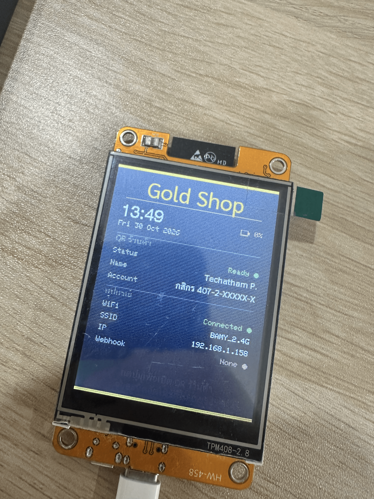
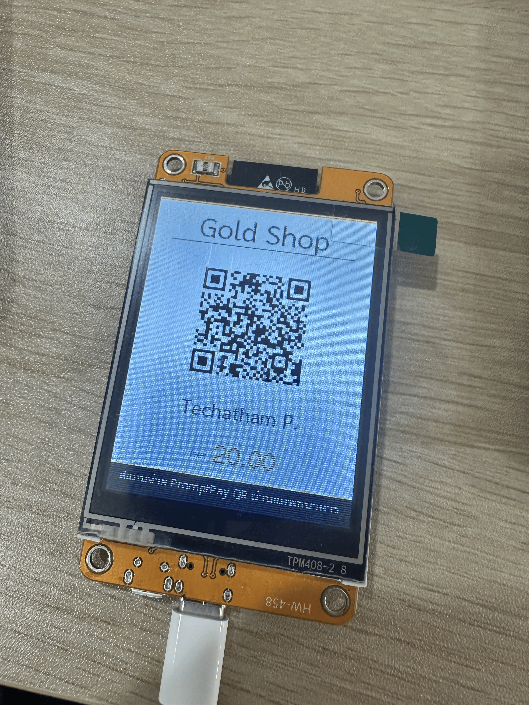
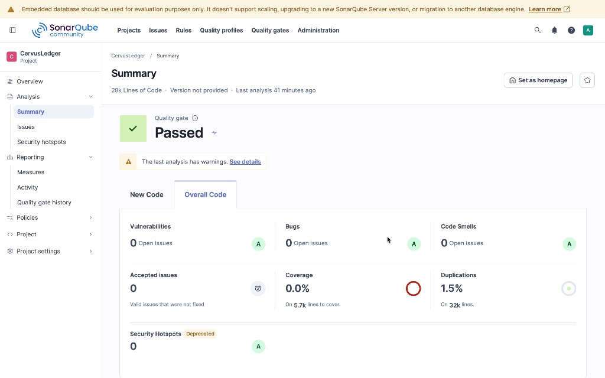

<p align="center">
  
</p>

<h1 align="center">CervusLedger</h1>

<p align="center">
  <strong>A native desktop management system for Thai gold shop operations</strong><br/>
  Built with Go + React via Wails — fast, offline-first, and purpose-built for real-world gold pawn shops.
</p>

<p align="center">
  
  
  
  
  
  
</p>

---

## 📑 Table of Contents

- [Overview](#-overview)
- [Key Features](#-key-features)
- [Tech Stack & Architecture](#-tech-stack--architecture)
- [Repository Structure](#-repository-structure)
- [Code Quality & Engineering Standards](#-code-quality--engineering-standards)
- [Getting Started](#-getting-started)
- [Building for Production](#-building-for-production)
- [License](#-license)

---

## 🔍 Overview

**CervusLedger** is a purpose-built desktop application designed for **Thai gold** (ร้านทอง). It replaces fragmented paper-based workflows with a unified digital ledger that handles everything from pawn ticket issuance and interest calculation to gold inventory management, daily cash reconciliation, and customer identity verification via smart card readers.

### Why Wails over Electron?

Unlike Electron-based alternatives that bundle an entire Chromium instance (~150 MB+), CervusLedger uses [Wails v2](https://wails.io/) to leverage the operating system's native webview. This results in:

- **Smaller binary** — ~15 MB compiled executable vs. 150 MB+ Electron bundles
- **Lower memory footprint** — native webview shares system resources efficiently
- **True native performance** — Go backend handles I/O, concurrency, and hardware access without Node.js overhead
- **Zero external dependencies** — SQLite is embedded; no database server required

---

## ✨ Key Features

### 🏦 Pawn Management (ระบบรับจำนำ)
- Create, edit, and track pawn records with **auto-generated ticket numbers**
- **Configurable interest rate engine** — threshold-based rate selection (low/high rate by principal amount)
- Monthly payment tracking with visual **overdue/pending status indicators**
- Full lifecycle support: **active → redeemed / forfeited**
- **Principal change history** — track reductions and adjustments over time
- **Ticket number change audit logs** with timestamps

### 🪙 Gold Inventory & Stock (คลังทอง)
- Catalog gold items by **type, subtype, purity, and weight (grams)**
- Monthly stock count logging with transaction IDs
- Baht/gram weight conversion using **Thai gold weight standards** (สลึง, บาท, กรัม)
- Stock quantity wizard for batch entry

### 💰 Sales & Purchases (ซื้อ-ขาย)
- **Sell, Buy, and Exchange** workflows in a unified tabbed modal
- Real-time price-per-baht calculation with negotiated price and discount tracking
- Gold type selection with **auto-populated weight and purity** from inventory catalog
- Printable **sale and purchase receipts** with Thai Baht text conversion (e.g., "สามหมื่นบาทถ้วน")

### 📊 Dashboard & Analytics
- At-a-glance **stat cards**: active pawns, monthly revenue, gold stock value, today's transactions
- **Chart.js-powered** revenue and income/expense trend graphs
- Real-time **gold price dashboard** — prices auto-fetched every 2 minutes from Thai gold market APIs
- Price history timeline with buy/sell spread visualization

### 📅 Income & Expense Tracking (บัญชีรายรับ-รายจ่าย)
- Monthly calendar grid with **daily cash balance summaries**
- Manual entry modal with configurable **preset categories** (color-coded)
- Daily cash reconciliation: expected vs. actual amount with variance tracking
- Bank transfer flag for each transaction

### 👤 Customer Management (ลูกค้า)
- Full customer profiles: name, phone, ID card, structured Thai address fields
- **🪪 Thai National ID Smart Card reader** — auto-populate customer data from physical ID cards via PCSC (APDU commands for CID, Thai/English name, date of birth, and address)
- Customer search with fuzzy matching across name and phone number
- Masked ID card display with click-to-reveal privacy control

### 🖥️ External Display (ESP32 Integration)
- Push live gold prices to an **ESP32-based external display** via WiFi
- Serial-over-USB provisioning workflow with QR code-based WiFi setup
- Local HTTP server for real-time display synchronization

| Main Interface | PromptPay QR Code |
| :---: | :---: |
|  |  |

### ⚙️ Settings & Configuration
- **Shop information** management (name, address, phone, PromptPay QR)
- Interest rate threshold and minimum interest configuration
- Pawn legal terms customization for printed tickets
- Ticket number sequence management
- **Excel data import** for migrating existing records
- Income/expense preset category editor with custom colors

### 🖨️ Receipt & Ticket Generation
- **Pawn tickets** (ตั๋วจำนำ) — fully formatted with customer details, item description, interest terms, and legal text
- **Sale receipts** — itemized with Thai Baht text amount and shop branding
- Print-ready layouts optimized for thermal and A4 printers

---

## 🛠️ Tech Stack & Architecture

| Layer | Technology | Purpose |
|-------|-----------|---------|
| **Desktop Runtime** | [Wails v2](https://wails.io/) | Native desktop shell with Go ↔ JS bridge |
| **Backend** | Go 1.25 | Business logic, database operations, hardware I/O |
| **Frontend** | React 18 + Vite | Single-page application with component-based UI |
| **Database** | SQLite (via [modernc.org/sqlite](https://pkg.go.dev/modernc.org/sqlite)) | Embedded, zero-config, file-based persistence |
| **Smart Card** | [ebfe/scard](https://github.com/ebfe/scard) (PCSC) | Thai National ID card reader integration |
| **Gold Price API** | [goquery](https://github.com/PuerkitoBio/goquery) | Web scraping Thai gold market prices |
| **Serial I/O** | [go-serial](https://pkg.go.dev/go.bug.st/serial) | ESP32 external display provisioning |
| **Excel Import** | [excelize](https://github.com/xuri/excelize) | Legacy data migration from spreadsheets |
| **Charts** | Chart.js | Dashboard visualizations |
| **Icons** | Font Awesome | UI iconography |
| **Code Quality** | SonarQube | Static analysis, bug detection, accessibility audits |

---

## 📁 Repository Structure

```
CervusLedger/
├── main.go                    # Application entry point & Wails bootstrap
├── app.go                     # App lifecycle (startup/shutdown hooks)
├── wails.json                 # Wails project configuration
├── go.mod / go.sum            # Go module dependencies
│
├── db/
│   └── database.go            # SQLite schema, migrations, and initialization
│
├── models/                    # Go data structures
│   ├── customer.go            # Customer model
│   ├── pawn.go                # Pawn records, payments, principal changes
│   ├── sale.go                # Sale transactions
│   ├── purchase.go            # Purchase records
│   ├── gold_item.go           # Gold inventory items
│   ├── gold_stock.go          # Stock catalog entries
│   ├── income_expense.go      # Income/expense entries
│   ├── daily_cash.go          # Daily cash balance
│   ├── dashboard.go           # Dashboard aggregation DTOs
│   └── settings.go            # App settings key-value pairs
│
├── handlers/                  # Go backend handlers (bound to frontend via Wails)
│   ├── customer_handler/      # CRUD + search for customers
│   ├── pawn_handler/          # Pawn lifecycle management
│   ├── sale_handler/          # Sale transaction processing
│   ├── purchase_handler/      # Purchase recording
│   ├── gold_item_handler/     # Gold inventory operations
│   ├── gold_price_handler/    # Live gold price fetching & history
│   ├── income_expense_handler/# Income/expense tracking
│   ├── dashboard_handler/     # Dashboard statistics aggregation
│   ├── settings_handler/      # App settings management
│   ├── smartcard_handler/     # Thai National ID card reader (PCSC/APDU)
│   ├── displayer_handler/     # ESP32 external display communication
│   └── txn.go                 # Transaction helper utilities
│
├── frontend/                  # React SPA (Vite)
│   ├── src/
│   │   ├── App.jsx            # Root component & routing
│   │   ├── pages/
│   │   │   ├── dashboard/     # Main dashboard with charts & stats
│   │   │   ├── pawns/         # Pawn list, detail, forms, modals, tickets
│   │   │   ├── sales/         # Sale/buy/exchange forms & history
│   │   │   ├── purchase_his/  # Purchase history & detail modals
│   │   │   ├── gold_stock/    # Gold inventory management & wizard
│   │   │   ├── customers/     # Customer list, profile, & forms
│   │   │   ├── income/        # Income/expense calendar & daily view
│   │   │   ├── settings/      # App configuration panels
│   │   │   └── smartcard/     # Smart card reader UI
│   │   ├── components/        # Shared UI components
│   │   │   ├── Sidebar.jsx    # Navigation sidebar
│   │   │   ├── StatCard.jsx   # Dashboard stat card
│   │   │   ├── GoldPriceDashboard.jsx
│   │   │   ├── GoldTypeSelectSection.jsx
│   │   │   ├── SmartCardWatcher.jsx
│   │   │   └── receipts/      # Pawn ticket & sale receipt renderers
│   │   └── utils/             # Frontend utilities
│   │       ├── thai.js        # Thai date formatting, Baht text conversion
│   │       ├── number.js      # Number formatting & weight conversion
│   │       ├── pawn.js        # Pawn business logic helpers
│   │       ├── date.js        # Date manipulation utilities
│   │       ├── smartcard.js   # Smart card data parsing
│   │       └── esp32Sync.js   # ESP32 display sync utilities
│   └── index.html
│
├── scripts/                   # Data import & migration scripts
│   ├── import.go              # Excel-to-SQLite data importer
│   └── data/                  # Sample/migration data files
│
├── build/                     # Build assets (icons, manifests)
└── sonar-project.properties   # SonarQube analysis configuration
```

---

## 🛡️ Code Quality & Engineering Standards

CervusLedger enforces strict **Clean Code** standards through continuous static analysis with **SonarQube**.

### Custom Quality Gate Strategy
Since this is an **individual full-stack project**, the Quality Gate was customized to fit a single-developer workflow:
- **Excluded Metric:** Test Coverage and automated unit test cases were intentionally excluded from the gate criteria.
- **Strict Focus:** The quality gate strictly enforces **0 Bugs, 0 Critical Vulnerabilities, and zero tolerance for high-severity Code Smells**.

### Refactoring Summary
Over **293 issues** were systematically identified and resolved via AI-assisted engineering workflows:

| Category | Examples of Fixes |
|----------|-------------------|
| **Bugs** | Unsafe `parseFloat` / `isNaN` replaced with `Number.parseFloat` / `Number.isNaN` across all components |
| **Code Smells** | Eliminated super-linear backtracking regex patterns in number formatting utilities |
| **Accessibility (a11y)** | Added ARIA roles (`dialog`, `gridcell`, `option`, `button`, `listbox`), `tabIndex`, `aria-selected`, `aria-modal`, and keyboard event handlers (`Enter`, `Space`, `Escape`, `ArrowUp/Down`) to all non-native interactive elements |
| **HTML Standards** | Linked all `<label>` elements to their corresponding `<input>`/`<select>` via `htmlFor` / `id` bindings |
| **Modal Patterns** | Replaced `e.stopPropagation()` anti-pattern with proper `e.target === e.currentTarget` backdrop guards and `Escape` key dismissal |



---

## 🚀 Getting Started

### Prerequisites

| Tool | Version | Installation |
|------|---------|-------------|
| **Go** | ≥ 1.25 | [golang.org/dl](https://golang.org/dl/) |
| **Node.js** | ≥ 18 | [nodejs.org](https://nodejs.org/) |
| **Wails CLI** | v2 | `go install github.com/wailsapp/wails/v2/cmd/wails@latest` |

### Local Development

```bash
# Clone the repository
git clone https://github.com/your-username/CervusLedger.git
cd CervusLedger

# Install frontend dependencies
cd frontend && npm install && cd ..

# Run in live development mode (hot reload enabled)
wails dev
```

This starts:
- A **Vite dev server** with hot module replacement for the React frontend
- The **Go backend** with automatic recompilation on changes
- A **native desktop window** displaying the application

> 💡 To access Go methods from a browser, connect to `http://localhost:34115` while `wails dev` is running.

---

## 📦 Building for Production

```bash
# Build a redistributable, production-optimized executable
wails build
```

The compiled binary will be output to the `build/bin/` directory. The resulting executable :
- Embeds all frontend assets (HTML, CSS, JS) into the Go binary
- Requires **no external runtime or dependencies**
- Creates its SQLite database at `~/CervusLedger/data.db` on first launch

### Cross-platform Building
To target specific operating systems or generate platform installers:

#### Windows (64-bit)
```bash
# Generates an NSIS installer executable
wails build -platform windows/amd64 -nsis

# Generates a standard standalone .exe binary
wails build -platform windows/amd64
```
#### macOS 
```bash
# Intel-based Macs
wails build -platform darwin/amd64

# Apple Silicon Macs (M-series)
wails build -platform darwin/arm64
```
#### Linux (64-bit)
```bash
wails build -platform linux/amd64
```
⚠️ Note: Cross-compiling for Windows or macOS from a Linux host (or vice versa) may require appropriate C compilers/tools installed on your system (e.g., MinGW for Windows targets).

## 📄 License

Copyright © 2026 **Techatham Panthumsinchai**. All rights reserved.
